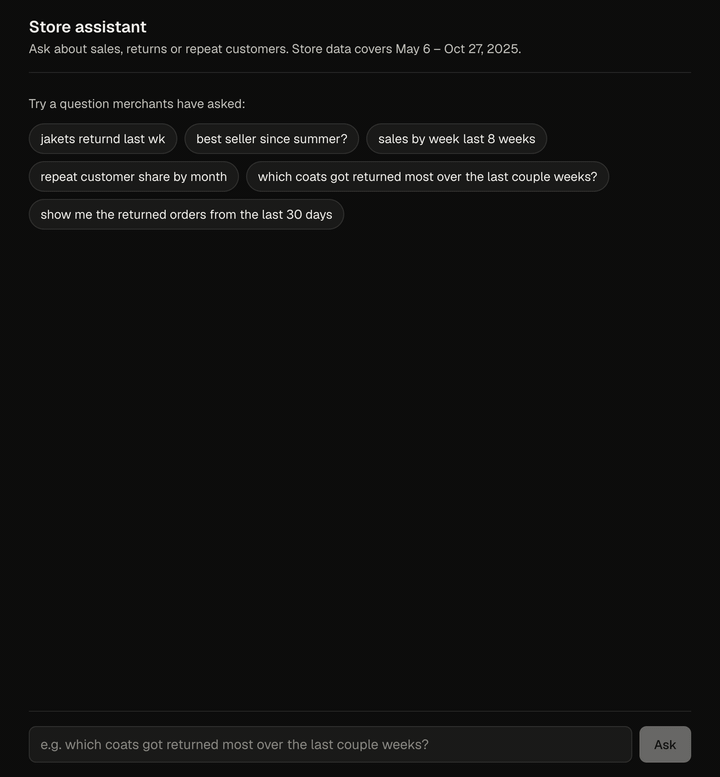

# Shopify Merchant Analytics

A chat dashboard for a Shopify store. The merchant asks a question in their own words, like "jakets returnd last wk", and gets a chart and a short answer.


## How it works

1. A free OpenRouter model reads the question and makes exactly one tool call: `salesReport`, `returnsReport`, `repeatCustomersReport` or `cannotAnswer`. The tool descriptions use the merchants' own words from `data/merchant-report-requests-2025-10-27.xlsx`.
2. Dates are worked out in code ("last week" is Oct 20–26) and given to the model as a table. The model copies dates; it never calculates them.
3. The tool runs a plain query over `data/orders.csv` and returns rows, totals and a chart spec. The model never sees the raw data or does arithmetic.
4. The page draws the chart, and the model writes a one-to-three-sentence answer from the result.

"Today" is Oct 27, 2025, the last day in the data. The default model is `baidu/ernie-5.5-flash-preview:free`, with two free fallbacks.

## Chart shapes

The code picks the chart from the shape of the result, not the model, so the same question always gets the same chart.

| Metric | Chart | Why |
| --- | --- | --- |
| Net sales over time | Line | Shows whether sales are going up or down. |
| Best sellers | Bar | Ranks products so the top ones stand out. |
| Sales by channel or category | Bar | Compares a few groups side by side. |
| Totals and averages (sales, orders, average order value) | Metric card | It's one number. |
| Returns by product or reason | Bar | Shows what comes back most, and why. |
| Return rate by category | Bar | Compares categories against what they sold. |
| Returned orders list | Table | Row-by-row detail to scan before a reorder. |
| Returns by size and reason | Table | Two breakdowns read better as a grid. |
| Repeat customer share by month | Line | Answers "are repeat customers growing?" |
| Repeat customers, repeat orders | Metric card | It's one count. |

## Loading state



While the model works, the reply shows what it's doing in grey, built from the real tool call: "Choosing a report…", then "Running the returns report for Oct 14–27: returned units by product, Outerwear only…". When the chart lands, the steps fold into "Show steps (3)" and the answer streams in underneath. If the model fails, the steps stay open and a message with "Try again" takes the chart's place.

## Built with Claude Code

The chat page came from this prompt (excerpt):

> Show the loading state inside the assistant's reply, where the answer will appear. No chart skeleton or spinner. Show the steps the assistant is taking in muted grey, in plain words, built from the tool call and result that `/api/chat` already streams. When the chart is ready, fold the steps into a collapsed "Show steps (3)" toggle above it. If something goes wrong, keep the steps visible and show a friendly message instead of the chart.

I checked it in the browser with real merchant questions, timing each stage of the reply and comparing every chart against the query engine. That led to four changes:

- The tool call and its result arrived together, so the middle steps never showed. Each step now stays on screen for at least 0.45s.
- The count axes showed fractions like 0.75. They now show whole numbers.
- A rate-limited model showed "Something went wrong" because retries hid the 429 error. It now says the model is busy, or that the daily limit is used up.
- The sales report showed "Returns 0" for a week when 4 jackets came back, because it counts returns on orders *placed* that week. It now adds a note with the number sent back.

## Live run

Five of Erik Vogt's acceptance questions (`data/acceptance-questions-erik-vogt.xlsx`), asked on the [Vercel preview](https://shopify-merchant-analytics-nvlrescgh-fuyofulo-613da217.vercel.app). The preview needs a Vercel sign-in. "First chart" is the time from pressing Ask to the chart appearing.

| ID | Question | Tool | Dates | First chart | Result |
| --- | --- | --- | --- | --- | --- |
| AQ-03 | which jackets came back the most last week | `returnsReport` | Oct 20–26 | 5.26s | Alpine Down Parka 3, Northridge 1. $792.15 refunded. |
| AQ-07 | what's my ad spend on Meta this month | `cannotAnswer` | none | no chart | Says ad spend isn't in the data. No chart. |
| AQ-02 | best sellers this season | `salesReport` | Sep 1 – Oct 27 | 2.99s | Alpine Down Parka first, at $854.10. |
| AQ-13 | revenue by wk recently | `salesReport` | Sep 28 – Oct 27 | 2.64s | Weekly line, peaking at $635.40 in the week of Oct 13. |
| AQ-08 | how are returns doing | `returnsReport` | May 6 – Oct 27 | 2.69s | 8 returns, $1,116.94 refunded. |

All five got the right tool and dates and rendered without a crash, and every number matches the data. Three of the four charts appeared within Erik's 5-second limit. AQ-03 took 5.26s, almost all of it waiting on the free model.

## Known limits

- The free model allows about 25 questions a day: 50 requests, and each question uses two.
- With 20 orders over six months, monthly percentages swing a lot. Repeat share jumps between 0% and 100%.
- Sales and returns can't share one chart. Money and counts would need two axes, and every chart here has one.

## Run it

```bash
npm install
cp .env.example .env.local    # add your free OpenRouter key
npm run dev                   # http://localhost:3000
npm test                      # 42 tests, no key needed
```

To deploy, run `vercel link`, then `vercel env add OPENROUTER_API_KEY preview --sensitive`, then `vercel deploy`. The key lives only in Vercel's encrypted settings and in `.env.local`, which git ignores.

## Code

```
src/lib/analytics/        query engine: metrics, breakdowns, dates, chart spec
src/lib/assistant/        tools, system prompt, model, the two-step stream
src/app/api/chat/         streaming chat route
src/components/           chat page and charts
tests/                    engine, tools and chat-page tests
```
