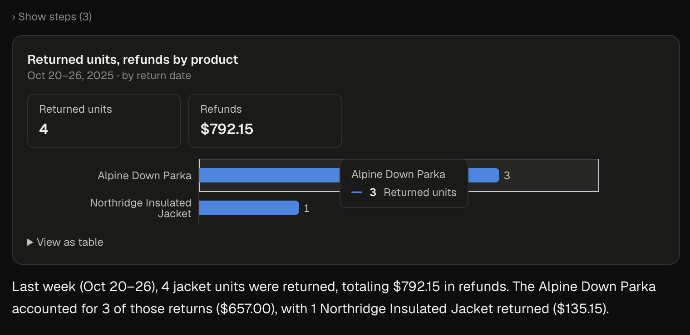

# Shopify Merchant Analytics

**Zero Uni · Project 1.** A Next.js app where a Shopify merchant asks questions about their store in their own words (*"jakets returnd last wk"*, *"best seller since summer?"*, *"are repeat customers growing or not"*) and gets a chart and a short answer, streamed back. While they wait, the reply shows the steps the assistant is taking, in plain words.

A free LLM on OpenRouter never reads the raw data and never does arithmetic. It picks **one** report tool, fills in **exact dates**, and then puts the tool's result into plain words. All numbers come from a deterministic query engine over the store's order history.



*"jakets returnd last wk": the steps have folded into "Show steps (3)", the tooltip on the Alpine Down Parka bar shows its 3 returned units, and the answer sits under the chart. Every number matches the data: 4 units and $792.15 refunded (Alpine Down Parka 3, $657.00; Northridge Insulated Jacket 1, $135.15).*

```
POST /api/chat  { "question": "jakets returnd last wk" }
   │
   ▼
Step 1: free OpenRouter model (Vercel AI SDK, toolChoice "required")
   │  picks one tool, copies exact dates from the date table in its instructions
   │  returnsReport({ startDate: "2025-10-20", endDate: "2025-10-26",
   │                  metrics: ["returned_units", "refunds"], groupBy: ["product"],
   │                  filters: { categories: ["Outerwear"] } })
   ▼
Query engine (this repo)  ──reads──▶  data/orders.csv
   │  { rows: [{ product: "Alpine Down Parka", returned_units: 3, refunds: 657 }, { product: "Northridge Insulated Jacket", … }],
   │    totals: { returned_units: 4, refunds: 792.15 }, chart: { type: "bar", title: "Returned units, Refunds by product", … } }
   ▼
Step 2: same model, no tools allowed (toolChoice "none")
   │  "Last week (Oct 20–26), 4 jacket units were returned, totaling $792.15 in refunds. The Alpine Down
   │   Parka accounted for 3 of those returns ($657.00), with 1 Northridge Insulated Jacket returned ($135.15)."
   ▼
Streamed to the client: tool call → tool result (rows + chart spec) → answer text
   │
   ▼
Chat page: grey steps while it works → chart pops in, steps fold to "Show steps (3)" → answer under the chart
```

## Status

| Part | State |
| --- | --- |
| Data layer: CSV parsing, validation, typed line items | ✅ Done |
| Query engine `queryStoreData`: metrics, breakdowns, filters, sorting, warnings | ✅ Done |
| Report tools described in merchants' own words (sales, returns, repeat customers) | ✅ Done |
| Streaming chat route `POST /api/chat`: free OpenRouter model, one tool call, exact dates | ✅ Done |
| Chart spec in every tool result (`stat` / `line` / `bar` / `table`) | ✅ Done |
| Chat page: grey steps while waiting, chart from the tool's `chart` field, answer under it | ✅ Done |
| Returned-order-lines list (`returnsReport` with `view: "list"`) | ✅ Done |
| Data API (`/api/analytics/query`, `/api/analytics/dataset`) | ✅ Done |
| Tests (42, no API key needed; numbers checked against values computed separately) | ✅ Done |
| Live-tested on a free model with real merchant questions, in the API and in the browser | ✅ Done |

## Quick start

Requires Node.js 22+.

```bash
npm install
cp .env.example .env.local      # then paste your OpenRouter key into it
npm run dev                     # open http://localhost:3000 and ask a question
```

```bash
curl -N -X POST http://localhost:3000/api/chat \
  -H 'content-type: application/json' \
  -d '{"question":"jakets returnd last wk"}'
```

Other scripts: `npm test` (vitest), `npm run typecheck`, `npm run lint`, `npm run build`.

### Environment (`.env.local`)

| Variable | Required | Description |
| --- | --- | --- |
| `OPENROUTER_API_KEY` | yes | Free key from [openrouter.ai/keys](https://openrouter.ai/keys). |
| `OPENROUTER_MODEL` | no | One model ID, or a comma-separated list tried in order. Defaults to the free models below. |
| `STORE_TODAY` | no | The date treated as "today" (`YYYY-MM-DD`). Defaults to the last day of data, `2025-10-27`. |

## The chat page

[`src/app/page.tsx`](src/app/page.tsx) is the merchant's chat. It uses the AI SDK's `useChat()` hook with `/api/chat`, and starts with six questions merchants actually asked (from the spreadsheet) as one-click suggestions.

**What the merchant sees in each reply**, in the same spot where the answer will appear:

1. **While waiting: the steps, in muted grey.** There's no chart skeleton and no spinner. The steps are built from the tool call and tool result that `/api/chat` already streams ([`steps.ts`](src/lib/assistant/steps.ts)), written in plain words, not code or JSON:
   - *Choosing a report…*
   - *Running the returns report for Oct 14–27, 2025: returned units, returns and refunds by product, Outerwear only…*
   - *Got results for 2 products*
2. **When the result lands: the chart pops in**, and the steps fold into a small closed toggle above it, **"Show steps (3)"**. Opening it shows every step. It stays closed by default, so it doesn't take space or attention from the chart.
3. **The short answer streams in under the chart.**
4. **If something goes wrong** (the free model is busy, the daily free limit is used up, the network drops), the steps stay visible with the failed one marked ✕. A friendly message with a **Try again** button takes the chart's place.

The report itself runs in milliseconds, so the tool call and its result usually arrive in the same instant. If they were shown as they arrive, the merchant would only ever read "Choosing a report…". So each real step stays on screen as the newest line for at least 0.45 seconds before the next one appears, and the chart lands after the last step. Nothing is invented: only steps that have already happened are shown.

**Measured in Chrome** for *"which coats got returned most over the last couple weeks?"* (from the spreadsheet). A `MutationObserver` recorded every change to the reply:

| Time | What the reply showed |
| --- | --- |
| 0.0s | Choosing a report… (grey) |
| 2.0s | ✓ Chose the returns report · Running the returns report for Oct 14–27, 2025: … Outerwear only… |
| 2.5s | Steps folded into "Show steps (3)" (closed). Chart: returned units and returns by product, 4 returns, $792.15 refunded |
| 3.8s | Answer streaming under the chart: "…the Alpine Down Parka was your most-returned coat with 3 units returned ($657.00 in refunds), followed by the Northridge Insulated Jacket with 1 unit ($135.15)…" |

**How each result is drawn.** The shape comes from the tool result's `chart.type`, never from the model ([`report-view.tsx`](src/components/report/report-view.tsx)):

- `stat`: metrics cards.
- `line`: a 2px line per metric with a hover crosshair and tooltip; empty weeks show as $0.
- `bar`: horizontal bars, so long product names stay readable, with the value at the tip.
- `table`: row-by-row, for the returned-items list and for two-breakdown results.

Every chart also has:

- **Totals as cards above the chart, and a "View as table" toggle.**
- **Formatting:** money as `$1,234.56`, percentages as `38.46%`, dates as `Oct 14–27, 2025`.
- **Warnings under the chart,** with a ⚠ and the text.
- **One axis only.** Only metrics that share the first metric's unit are plotted (e.g. net sales and refunds, both money). The rest, like a return rate, stay in the cards and the table.
- **Colours in light and dark mode** from a palette checked for colour-blind separation (`globals.css`). Text never uses a series colour.

**Other questions checked in the browser** (numbers checked against the query engine):

| Question | What came back |
| --- | --- |
| sales by week last 8 weeks | Line, Sep 1 – Oct 26: $2,310.15; hover on the peak shows "Week of Oct 13, 2025 · $635.40". |
| show me the returned orders from the last 30 days | Table of 6 returned lines, newest first, totals 6 returns / $994.94. |
| whats my avg sale per customer this month | Metrics card: $188.44 (Oct 1–27: $2,261.25 across 12 customers). |
| Hi team, … which parkas and puffers had the most returns from Sept 1 through last Sunday? … by product | Bar, Sep 1 – Oct 26: Alpine Down Parka 3 ($657.00), Northridge Insulated Jacket 2 ($263.94), total $920.94. |
| Can I see sales and returns for jackets last week? Need both on one chart… | Bar of net sales by product (one axis); return rate in the cards. The free model's daily limit ran out before the answer step. That's how we found that 429 errors were reaching the merchant as a generic message (now fixed, see below). |
| (any question, with a model name that doesn't exist) | Step marked ✕ "Couldn't reach the AI model", friendly message and Try again in place of the chart. |

Two fixes came out of the browser testing:

- **"Returns 0" in the sales report was easy to misread.** In `salesReport`, returns belong to the orders *placed* in the period (so a return rate compares like with like), but 4 jackets were *sent back* that week. Sales results with return metrics now carry a warning, *"Returns here are from orders placed in these dates. Counted by return date, 4 items were sent back during these dates."*, which shows under the chart and which the model passes on.
- **Rate-limit errors are now named correctly.** Retries wrap the provider's 429 in an `AI_RetryError`, so it used to fall through to "Something went wrong". [`errors.ts`](src/lib/assistant/errors.ts) unwraps it. A short busy spell says "try again in a minute"; the daily free cap says it resets at midnight UTC.

### Built with Claude Code: the prompt, and what was checked

The chat page was built from this prompt (excerpt):

> On the chat page, show the loading state inside the assistant's reply bubble, in the same spot where the answer will appear. Don't add a chart skeleton or a spinner. While the merchant waits, show the steps the assistant is taking as a short list in muted grey text, built from the tool call and tool result that `/api/chat` already streams. Write each step in plain words, not code or JSON. […] When the chart is ready, have it pop in below the steps. At that moment, fold the steps into a small collapsed toggle above the chart, like "Show steps (3)". […] If something goes wrong, for example the free model is busy, keep the steps visible and show a friendly message in place of the chart.

What I checked:

- **Steps first, then the fold.** In Chrome, a `MutationObserver` recorded every change to the reply for a vague-date question ("which coats got returned most over the last couple weeks?"). The order was grey steps, then the chart with the steps folded, then the answer (timeline above).
- **The tooltip.** Hovering a bar on the jacket returns chart shows the product and its return count (screenshot at the top).
- **The numbers.** Every chart was compared with the query engine: jacket returns, 8-week sales, the 30-day returns list, sales per customer, and the parkas and puffers question.
- **The failure path.** A server started with a model name that doesn't exist showed the ✕ step, the friendly message and Try again.

What I changed because of those checks:

- **Each step now stays readable.** The tool call and its result arrived together, so the merchant only ever saw "Choosing a report…". Each real step now stays on screen for at least 0.45 seconds.
- **Whole numbers on count axes.** The returns axis was showing 0.75 and 2.25.
- **Rate-limit errors are unwrapped.** Retries hid the 429, so a busy model showed "Something went wrong". It now shows the friendly message, and the free daily cap has its own message.
- **Sales results with returns now carry a note.** That note gives the by-return-date count too, so "Returns 0" isn't misread.
- **The model no longer says "No data issues to flag"** when there are no warnings.

## The chat route: `POST /api/chat`

**Request:** `{ "question": "..." }` for a single question, or `{ "messages": UIMessage[] }`, which is what the AI SDK's `useChat()` sends.

**Response:** an [AI SDK UI message stream](https://ai-sdk.dev/docs/ai-sdk-ui/stream-protocol) (server-sent events), which `useChat()` reads directly. It carries:

1. the tool call, with the exact dates and query the model chose,
2. the tool result: `rows`, `totals`, `columns`, `warnings` and a `chart` spec,
3. the model's answer, streamed as text.

How it guarantees **one tool call with exact dates**:

- **Exactly one tool call.** Step 1 runs with `toolChoice: "required"`, so the model must call a tool. Step 2 runs with `toolChoice: "none"`, so it can only write the answer. `stopWhen: stepCountIs(2)` ends the run there. The provider is asked for `parallel_tool_calls: false`. As a final guard, the tools for each request share a flag, so only the first call runs and any extra call gets an error back.
- **Exact dates.** Free models are unreliable at date arithmetic, so the code works the dates out itself ([`periods.ts`](src/lib/analytics/periods.ts)). It turns the time phrases merchants actually used into exact dates and puts that table in the system prompt. Every tool requires `startDate` and `endDate` as `YYYY-MM-DD`, validated by Zod. The model copies dates; it doesn't calculate them.
- **Answers only from the result.** Temperature is 0. The instructions say to use only numbers from the tool result and to pass on its warnings (dates with no data, products the store doesn't sell).
- **Charts that draw correctly.** Day, week and month breakdowns always come back complete and in date order, even if the model asks to sort them, so they draw as a line.

Free models sometimes time out partway through a response. `streamRetries: 2` reruns just that step. If the model is still unavailable, the stream ends with a readable message ("The free AI model is busy right now…") rather than a stack trace ([`errors.ts`](src/lib/assistant/errors.ts)).

### Live results (free model, real questions from the spreadsheet)

These come from `POST /api/chat` with the default model, `baidu/ernie-5.5-flash-preview:free`. In every case the model made exactly one tool call, and every number was checked against the data.

| Merchant question | Tool call the model made | Answer (abridged) |
| --- | --- | --- |
| jakets returnd last wk | `returnsReport` 2025-10-20 → 2025-10-26, returned units and refunds by product, category Outerwear | 4 jacket units returned, $792.15 refunded: Alpine Down Parka 3 ($657.00), Northridge Insulated Jacket 1 ($135.15). |
| best seller since summer? | `salesReport` 2025-06-01 → 2025-10-27, net_sales by product | The Alpine Down Parka, $854.10, ahead of the Northridge Insulated Jacket at $596.25. |
| sales by week last 8 weeks | `salesReport` 2025-09-01 → 2025-10-26, net_sales by week | $2,310.15 over 8 weeks. Peaked the week of Oct 13 at $635.40. No sales in the weeks of Sep 1 and Sep 15. Most recent week $543.50. |
| top 10 products by revenue Oct 1 to Oct 15 | `salesReport` 2025-10-01 → 2025-10-15, net_sales by product, limit 10 | Alpine Down Parka $657.00, Northridge $294.15, Selvedge Jeans $212.40. Only 6 products sold that fortnight. |
| Our sneaker returns feel really high recently… is it a sizing thing? | `returnsReport` 2025-09-28 → 2025-10-27, returns by product and reason | The store doesn't sell sneakers. Across all products, 6 returns ($994.94) in the last 30 days, led by the Alpine Down Parka. |
| repeat customer share by month | `repeatCustomersReport` all data, repeat_order_share by month | 40% overall. By month 0%, 100%, 0%, 100%, 50%, then 38.46% in October (5 of 13). |
| how many customers came back twice | `repeatCustomersReport` all data, repeat_customers | 7 customers came back and placed repeat orders. |
| what was my ROAS on the fall jacket campaign? | `cannotAnswer` "ad spend and campaign performance" | Can't calculate ROAS without ad spend. Offers Outerwear sales instead. |
| daily sales over Black Friday weekend last year compare to now? | `salesReport` 2024-11-29 → 2024-12-01, by day | No data before May 6, 2025. Offers a recent period instead. |

### Dates the model is given (today = Monday 2025-10-27)

The order data is historical. It ends on 2025-10-27, the same day the merchant report requests were sent, so that is "today" by default.

| Merchant says | Dates |
| --- | --- |
| "last week", "last wk", "through last Sunday" | 2025-10-20 → 2025-10-26 |
| "this week" | 2025-10-27 → 2025-10-27 |
| "last 7 days" | 2025-10-21 → 2025-10-27 |
| "last 14 days", "last couple of weeks" | 2025-10-14 → 2025-10-27 |
| "last 30 days", "lately", "recently" | 2025-09-28 → 2025-10-27 |
| "last 8 weeks" (full Mon–Sun weeks) | 2025-09-01 → 2025-10-26 |
| "this month" | 2025-10-01 → 2025-10-27 |
| "last month" | 2025-09-01 → 2025-09-30 |
| "this season" (fall) | 2025-09-01 → 2025-10-27 |
| "since summer" | 2025-06-01 → 2025-10-27 |
| no period mentioned | 2025-05-06 → 2025-10-27 (all data) |

## The tools, in merchants' words

Each tool's description starts with a plain sentence built from phrases in the **Merchant Question** column of [`data/merchant-report-requests-2025-10-27.xlsx`](data/merchant-report-requests-2025-10-27.xlsx) (30 real requests). After it come some of the requests themselves, quoted as written, typos included. The model picks a tool by matching the merchant's words to these descriptions ([`tools.ts`](src/lib/assistant/tools.ts)).

| Tool | Description (first sentence) | Example requests from the file |
| --- | --- | --- |
| `salesReport` | See your sales and revenue for any stretch of time (per day, by week, last month or since summer) and which products are your best sellers by revenue or by units sold, so you know what sold best before BFCM. | "best seller since summer?", "sales by week last 8 weeks", "top 10 products by revenue Oct 1 to Oct 15", "revenue last month" |
| `returnsReport` | See how your returns are doing: which products or categories got returned the most, how much you refunded, and why they came back, so you can tell if it's a sizing thing before you reorder. | "jakets returnd last wk", "most returned category", "which styles are coming back the most? Is it a sizing thing?" |
| `repeatCustomersReport` | See how many customers came back to order a 2nd time and what share of your orders come from repeat customers each month, so you know whether repeat customers are growing or not. | "are repeat customers growing or not", "repeat customer share by month", "how many customers came back twice" |
| `cannotAnswer` | The store's order data can't answer this question (ad spend, ROAS, traffic, stock, costs). | "what was my ROAS on the fall jacket campaign?", "how much did we spend on instagram ads" |

Merchants use *came back* and *returning* in two senses: products coming back as returns, and customers coming back to order again. The descriptions spell out which sense belongs to which tool.

Each report tool only accepts the metrics and breakdowns that fit its job, which keeps the schema small enough for a free model:

| Tool | Metrics | Group by |
| --- | --- | --- |
| `salesReport` | net_sales, units_sold, orders, customers, average_order_value, sales_per_customer, gross_sales, discounts, discount_rate, net_revenue, units_per_order, returns, refunds, return_rate | day, week, month, product, category, variant, size, color, sales_channel, customer_type, fulfillment_status |
| `returnsReport` | returns, returned_units, refunds, customers_with_returns | day, week, month, product, category, variant, size, color, return_reason, sales_channel, customer_type |
| `repeatCustomersReport` | repeat_order_share, repeat_orders, repeat_customers, orders, customers, net_sales, units_sold, sales_per_customer, average_order_value | day, week, month, customer_type, product, category, sales_channel |

**Each tool has one meaning of the period.** `returnsReport` counts items by the date they **came back**, so "jackets returned last week" means returned last week, whenever they were ordered. `salesReport` counts **orders placed** in the period. Return rates and "returns vs sales" therefore live in `salesReport`, which compares the same orders on both sides.

An early version switched the returns tool to order dates when the model added `return_rate`. The free model did add it, and "jakets returnd last wk" came back as zero. Giving each tool a single meaning fixed it.

### Model: free OpenRouter models only

The job is simple: pick one of four tools and copy dates from a table. So a fast free model works, and nothing here needs a paid model. To choose one, I ran the same two spreadsheet questions ("best seller since summer?" and the sneaker-returns/sizing question) through every free OpenRouter model that supports tool calling and `tool_choice`:

| Free model | Right tool + exact dates | Notes | Time per answer |
| --- | --- | --- | --- |
| `baidu/ernie-5.5-flash-preview:free` | 2 / 2 | Correct numbers. Said the store doesn't sell sneakers. Used return reasons to answer the sizing question. | ~4s |
| `inclusionai/ling-3.2-flash:free` | 2 / 2 | Correct numbers. Broke returns down by size. | 6–19s |
| `nvidia/nemotron-3-ultra-550b-a55b:free` | 2 / 2 | Correct numbers. | 11–22s |
| `nvidia/nemotron-3.5-lightning:free` | 1 / 2 | Gave up on the sneaker question (`cannotAnswer`). | 3–7s |
| `google/gemma-4-31b-it:free` | 0 / 2 | No output (timed out). | — |

The default in [`model.ts`](src/lib/assistant/model.ts) is the top three, in that order. They are sent as an [OpenRouter fallback list](https://openrouter.ai/docs/features/model-routing), so if the first is rate-limited or down, OpenRouter tries the next. You can override the list with `OPENROUTER_MODEL`. OpenRouter rate-limits free models per minute and per day. Without credits on the account the daily cap is 50 requests, and each question uses two, so about 25 questions a day.

## Chart shapes

The rule:

- **Metrics card:** one number.
- **Line:** change over time.
- **Bar:** comparing products, categories, channels or reasons.
- **Table:** row-by-row detail, or two breakdowns at once.

The `chart` field in each tool result chooses a metrics card (`stat`), `line`, `bar` or `table` from the shape of the result ([`chart.ts`](src/lib/analytics/chart.ts)), and the chat page draws exactly that.

| Metric | Tool and breakdown | Shape | Why |
| --- | --- | --- | --- |
| Net sales over time | `salesReport` by week or month | Line | Shows whether sales are going up or down. |
| Best sellers (net sales or units by product) | `salesReport` by product | Bar | Ranks products so the top sellers stand out. |
| Sales by channel or category | `salesReport` by sales_channel or category | Bar | Compares a handful of channels or categories side by side. |
| Total sales, orders, units, customers for a period | `salesReport`, no breakdown | Metrics card | Each is a single number. |
| Average order value, sales per customer, units per order | `salesReport`, no breakdown | Metrics card | Each is one average for the period. |
| Gross sales, discounts, discount rate, net revenue | `salesReport`, no breakdown | Metrics card | Single totals the merchant reads at a glance. |
| Return rate by category | `salesReport` by category | Bar | Compares how often each category comes back, relative to what sold. |
| Returns and refunds by product or category | `returnsReport` by product or category | Bar | Shows which products come back the most. |
| Returns by reason | `returnsReport` by return_reason | Bar | Shows why items come back, e.g. sizing vs. changed mind. |
| Returns over time | `returnsReport` by week or month | Line | Shows whether returns are rising. |
| Total returns, refunds, customers with returns | `returnsReport`, no breakdown | Metrics card | Each is a single number. |
| Returns by size and reason ("is it a sizing thing?") | `returnsReport` by size and return_reason | Table | Two breakdowns at once read more clearly as a grid. |
| List of returned order lines (order, date, product, size, reason, refund) | `returnsReport` list option | Table | Row-by-row detail the merchant can scan before a reorder. |
| Repeat order share by month | `repeatCustomersReport` by month | Line | Answers "are repeat customers growing or not". |
| Repeat customers, repeat orders for a period | `repeatCustomersReport`, no breakdown | Metrics card | Each is a single count. |
| What repeat customers buy | `repeatCustomersReport` by product, filter repeat | Bar | Ranks the products people come back for. |

Notes:

- **The returned-order-lines list** is `returnsReport` with `view: "list"` ([`list.ts`](src/lib/analytics/list.ts)). It returns one row per returned line, newest first: date returned, order, product, size / colour, reason, refund.
- **Two breakdowns at once** (e.g. size and reason) always come back as `table`.
- **Use weeks or months for lines, not days.** The data has 20 orders in six months, so a daily line would be mostly zeros.
- **The monthly repeat share swings a lot**, between 0% and 100%, because some months have only one or two orders. Show the order count beside it.

## The query engine: `queryStoreData`

All three report tools are thin wrappers around one function:

```ts
import { queryStoreData } from "@/lib/analytics";

const result = queryStoreData({
  startDate: "2025-05-06",               // inclusive, YYYY-MM-DD
  endDate: "2025-10-27",                 // inclusive, YYYY-MM-DD
  metrics: ["net_sales", "units_sold"],
  groupBy: ["product"],                  // optional, up to 2 dimensions
  filters: { customerType: "repeat" },   // optional
  limit: 5,                              // optional, "top 5"
});
```

### Input

| Field | Required | Description |
| --- | --- | --- |
| `startDate`, `endDate` | yes | The period, inclusive (`YYYY-MM-DD`). |
| `metrics` | yes | What to measure (see below). The first metric is the default sort key. |
| `groupBy` | no | Up to two dimensions, e.g. `["product"]` or `["month", "sales_channel"]`. If empty, you get one overall row. |
| `filters` | no | `products`, `categories`, `salesChannels`, `customerType` (`new`/`repeat`), `customerIds`, `orderIds`, `sizes`, `colors`, `fulfillmentStatuses`, `returned`, `returnReasons`. Text matching ignores case. Values within one list are OR-ed, and different filters are AND-ed. `products` accepts an ID or part of a title (`"parka"`). |
| `dateField` | no | `order_date` (default) or `return_date`. |
| `sortBy`, `sortDirection` | no | Rank rows by any metric (`desc` by default). Time breakdowns default to chronological order. |
| `limit` | no | Maximum rows. `totals` still cover everything. |

### Metrics

| Key | Meaning |
| --- | --- |
| `net_sales` | Sales after discounts, before refunds (sum of line totals). Default meaning of "sales" or "revenue". |
| `gross_sales` | Sales before discounts (quantity × unit price). |
| `discounts` / `discount_rate` | Discounts given, and as a % of gross sales. |
| `refunds` | Total refunded on returned items. |
| `net_revenue` | Net sales − refunds. |
| `orders` / `line_items` / `units_sold` / `customers` | Distinct orders, order lines, quantity sold, distinct customers. |
| `average_order_value` | Net sales ÷ orders. |
| `sales_per_customer` | Net sales ÷ customers. |
| `units_per_order` | Units ÷ orders. |
| `returns` / `returned_units` | Returned line items / quantity. |
| `customers_with_returns` | Distinct customers who returned something. |
| `return_rate` | Returned units as a % (0–100) of units sold. |
| `repeat_orders` | Orders from customers who had ordered before. |
| `repeat_customers` | Distinct customers who placed a repeat order. |
| `repeat_order_share` | Repeat orders as a % (0–100) of all orders. |

Dimensions: `day`, `week` (Monday start), `month`, `product`, `category`, `variant`, `size`, `color`, `sales_channel`, `customer_type` (`new` / `repeat`), `customer`, `fulfillment_status`, `return_reason`, `order`.

### Output

```jsonc
{
  "query":   { /* the validated query, defaults filled in */ },
  "period":  { "startDate": "...", "endDate": "...", "dateField": "order_date",
               "dataAvailable": { "startDate": "2025-05-06", "endDate": "2025-10-27" } },
  "columns": [ { "key": "product", "label": "Product", "role": "dimension", "format": "text" },
               { "key": "net_sales", "label": "Net sales", "role": "metric", "format": "currency" } ],
  "rows":    [ { "product": "Alpine Down Parka", "net_sales": 854.1 }, ... ],
  "totals":  { "net_sales": 3098.35 },   // over everything matched, ignoring limit
  "matchedLineItems": 28,
  "totalRows": 11,
  "truncated": true,
  "warnings": [],                         // e.g. unknown filter values, period outside the data
  "chart":   { "type": "bar", "title": "Net sales by product", "x": {…}, "metrics": [ … ] }
}
```

(`chart` is added by the chat tools.)

- **Charts.** `columns` and `chart` tell a UI how to draw the result without guessing. A time breakdown becomes a `line` chart, a category breakdown a `bar` chart, no breakdown a `stat` card, and two breakdowns a `table`.
- **Empty periods.** A single time breakdown includes empty buckets as zeros, so trend charts don't skip periods. Ratios that can't be computed are `null`, not `0`.
- **Warnings.** They tell the model what to pass on to the merchant. If a filter names a channel the store doesn't have, the warning lists the ones that exist. If the dates fall outside the data, it gives the range that has data.

## Example answers from the data

| Question | Answer |
| --- | --- |
| How many customers have returned products, and why? | 8 customers returned 8 items, with $1,116.94 refunded. Reasons: Too small (2), Too large (2), Changed mind (2), Defective (1), Not as pictured (1). |
| What are our top-selling products? | Alpine Down Parka $854.10, Northridge Insulated Jacket $596.25, Selvedge Slim Jeans $436.60, … |
| Which jackets came back as returns last week? | 4: Alpine Down Parka ×3, Northridge Insulated Jacket ×1. $792.15 refunded. |
| Returns in the last 30 days? | 6 returns, $994.94 refunded: Alpine Down Parka 3, Northridge Insulated Jacket 2, Utility Chino 1. |
| Are repeat customers growing? | 40% of all orders are repeat orders. By month: Sep 50%, Oct 38.46% (5 of 13). |
| Which sales channel is used the most? | Online Store: 11 of 20 orders, $1,882.20. |
| How many sales did we do last week / last month? | 4 orders, $543.50 / 2 orders, $231.10. |

## HTTP API

| Endpoint | Purpose |
| --- | --- |
| `GET /` | The chat page. |
| `POST /api/chat` | Ask a question. Streams the tool call, result and answer. |
| `POST /api/analytics/query` | Run `queryStoreData` directly with a JSON body. An invalid query returns `400` with field errors. |
| `GET /api/analytics/dataset` | What the data contains: date coverage, products, channels, return reasons, metrics, dimensions. |

## Project structure

```
.
├── data/
│   ├── orders.csv                              # Store order history, May–Oct 2025 (one row per line item)
│   └── merchant-report-requests-2025-10-27.xlsx # 30 real merchant questions; source of the tool wording
├── src/
│   ├── app/
│   │   ├── page.tsx                  # The chat page (suggested questions from the spreadsheet)
│   │   ├── globals.css               # Colour tokens (light + dark), chart palette, pop-in animation
│   │   └── api/
│   │       ├── chat/route.ts         # POST: streaming chat (OpenRouter + AI SDK)
│   │       └── analytics/
│   │           ├── query/route.ts    # POST: run queryStoreData
│   │           └── dataset/route.ts  # GET: describeDataset
│   ├── components/
│   │   ├── chat/
│   │   │   ├── chat.tsx              # useChat(), message list, input, suggestions
│   │   │   ├── assistant-reply.tsx   # Grey steps → chart + "Show steps (N)" → answer; error state
│   │   │   └── answer-text.tsx       # The model's short answer (paragraphs, bullets, bold)
│   │   └── report/
│   │       ├── report-view.tsx       # Picks cards / line / bar / table from chart.type; warnings
│   │       ├── line-view.tsx, bar-view.tsx, chart-parts.tsx   # Recharts, one axis, tooltip, legend
│   │       └── data-table.tsx        # Row-by-row table (and "View as table")
│   └── lib/
│       ├── format.ts                 # Money, percentages, dates, axis ticks
│       ├── assistant/                # The LLM side
│       │   ├── tools.ts              # salesReport, returnsReport, repeatCustomersReport, cannotAnswer
│       │   ├── instructions.ts       # System prompt: today, date table, catalogue, one-call rule
│       │   ├── answer.ts             # streamMerchantAnswer(): step 1 tool call, step 2 answer
│       │   ├── model.ts              # OpenRouter free model(s) from env
│       │   ├── steps.ts              # Streamed tool call → plain-English steps
│       │   ├── errors.ts             # Provider errors → a sentence the merchant can act on
│       │   └── ui-types.ts           # Typed chat messages for useChat()
│       ├── analytics/                # The query engine (no LLM)
│       │   ├── query.ts              # queryStoreData(): filter → group → compute → sort → limit
│       │   ├── schema.ts             # Zod input schema
│       │   ├── metrics.ts            # Metric definitions
│       │   ├── dimensions.ts         # groupBy dimensions
│       │   ├── filters.ts            # Filters + "unknown value" warnings
│       │   ├── periods.ts            # Merchant time phrases → exact dates
│       │   ├── dates.ts              # Day/week/month bucketing
│       │   ├── chart.ts              # Chart spec from a result
│       │   ├── list.ts               # Returned items, one row per line
│       │   ├── describe.ts           # describeDataset()
│       │   └── examples.ts           # Example questions → queries
│       └── store-data/               # Loading the raw CSV
│           ├── csv.ts, parse.ts, load.ts, types.ts
└── tests/
    ├── analytics.test.ts             # Query engine
    ├── assistant.test.ts             # Dates, tools, and the two-step chat flow (mock model)
    └── chat-page.test.ts             # Chart shapes, returns list, step wording, formatting, error messages
```

To add a metric, add an entry to `METRICS` in `metrics.ts`. To add a dimension, add one to `DIMENSIONS` in `dimensions.ts`. To make either available to the model, also add it to the list for the right tool in `tools.ts`.

## The data

`data/orders.csv` is the store's order export for May–October 2025: 28 line items across 20 orders, 18 customers and 11 products.

- **Grain:** one row per order line item. Orders and customers are counted as distinct IDs, never as rows.
- **`is_repeat_customer`** describes the order: `true` means the customer had ordered before, so this is a repeat purchase.
- **`line_total`** = `quantity × unit_price − discount_amount`, and that is what "net sales" sums.
- **Refunds can be partial**: e.g. one $143.10 line was refunded $128.79.
- **`variant`** (`"M / Black"`) is split into `size` and `color`.
- Money is summed in integer cents, so totals are exact.

Some merchant questions ask about things this store doesn't have: sneakers, bags, last year's Black Friday, ad spend. The assistant says so instead of guessing.

## Tech

Next.js 16 (App Router, TypeScript), Vercel AI SDK 7 with `@ai-sdk/react` (`useChat`), OpenRouter (`@openrouter/ai-sdk-provider`), Recharts 3, Zod 4, Tailwind CSS 4, Vitest.
